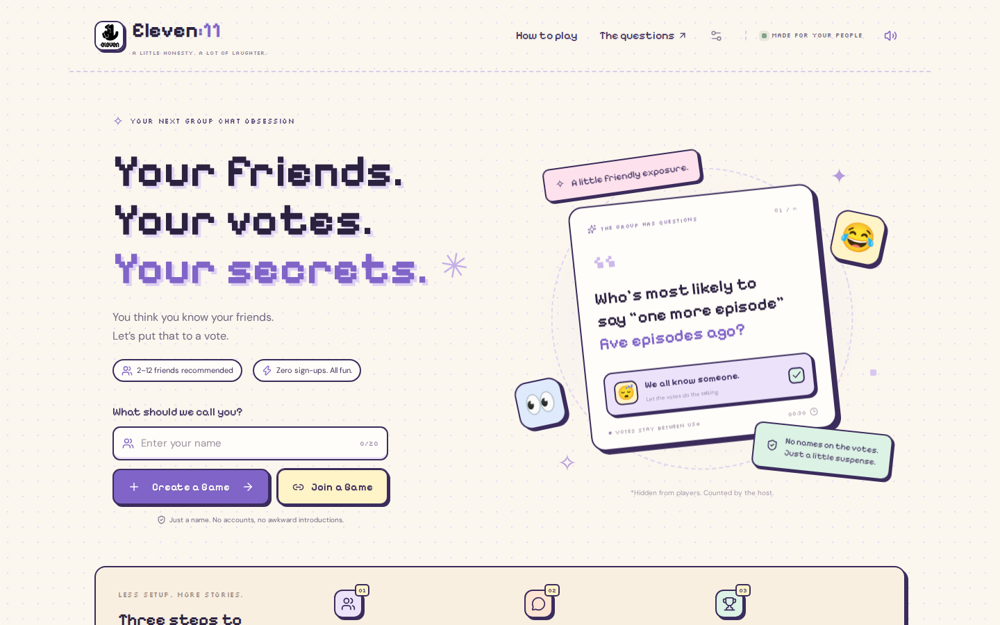
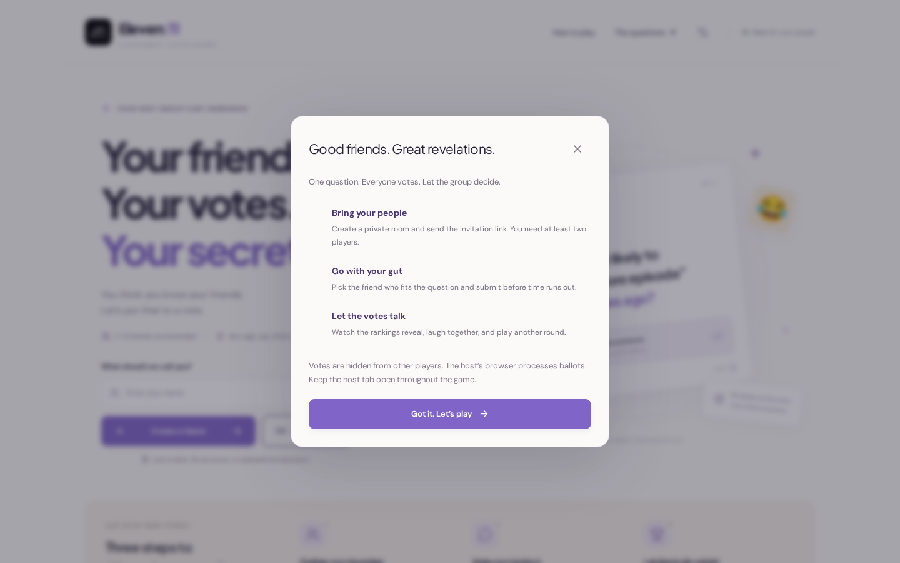
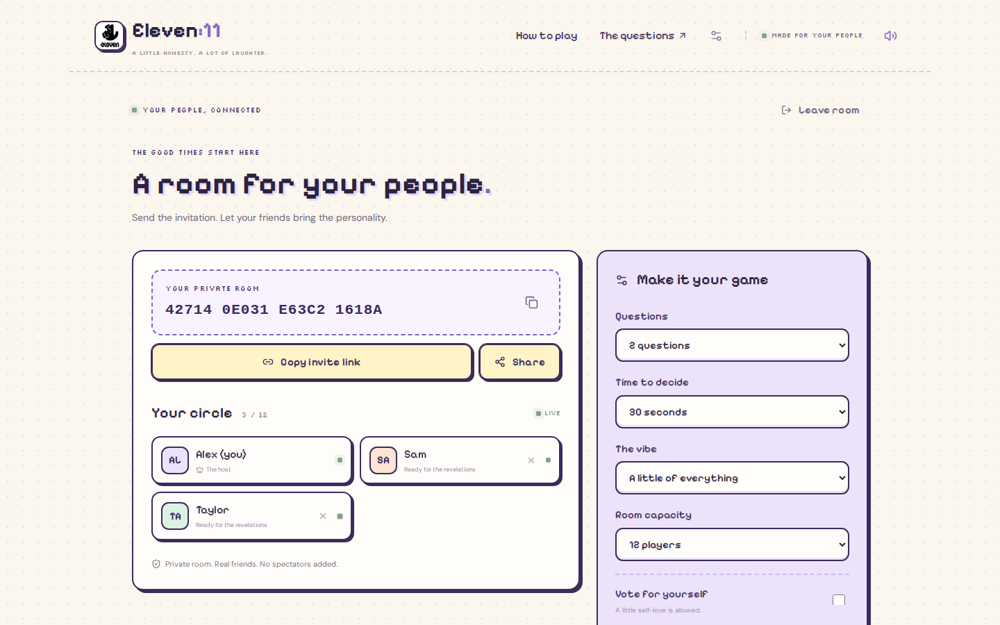
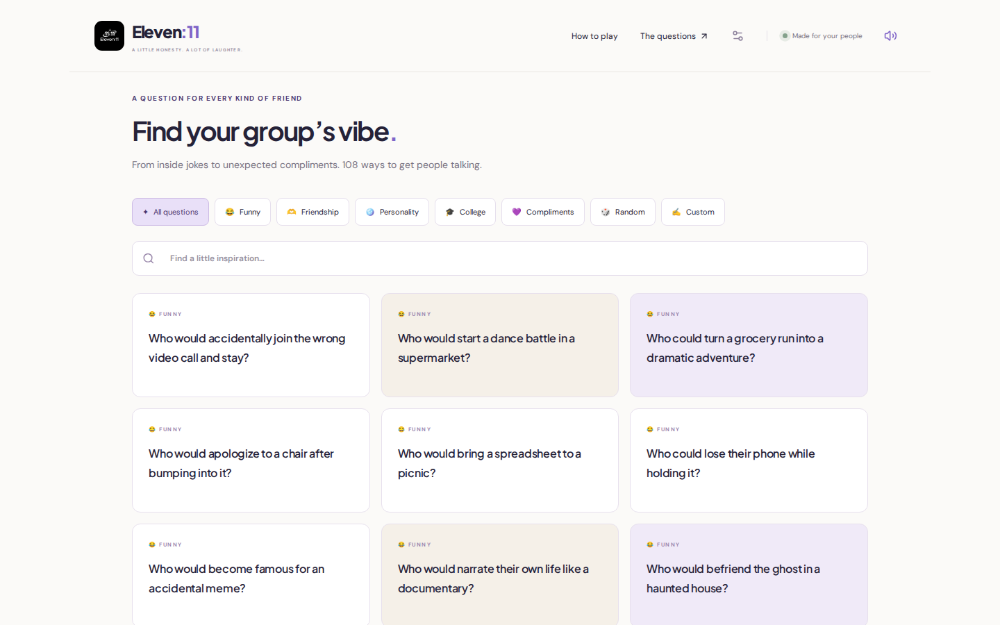
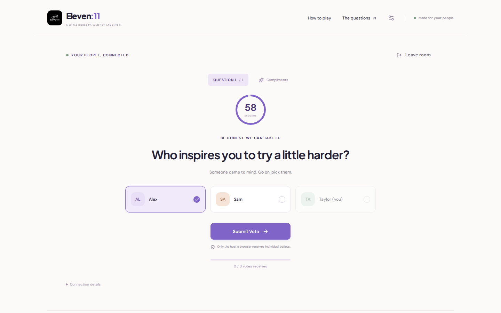
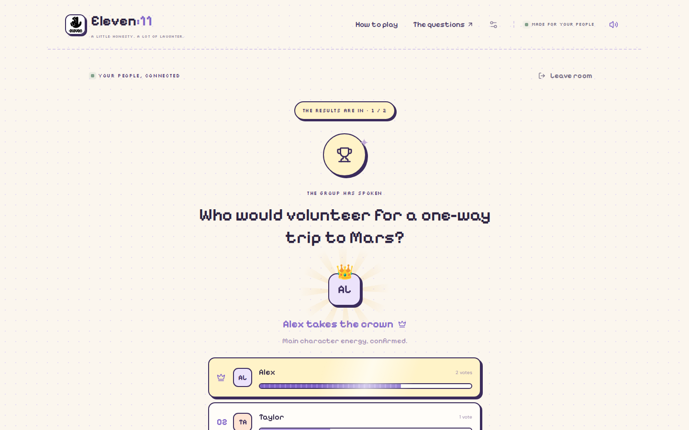
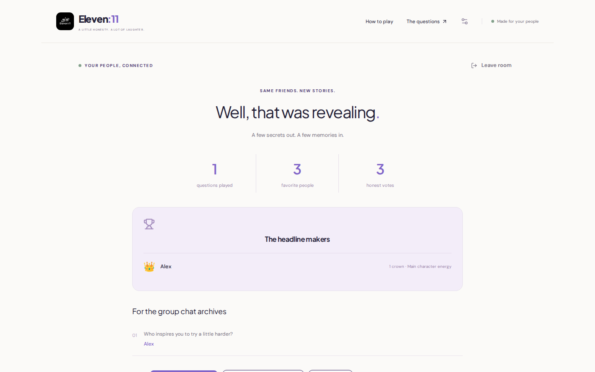

<div align="center">


# Eleven:11

**Your friends. Your votes. Your secrets.**

A serverless party game where friends vote on who's most likely to… — peer-to-peer over WebRTC, no accounts, no backend.


[Screenshots](#-screenshots) · [Installation](#-installation) · [How to play](#-how-to-play) · [Deployment](#-deployment) · [How it works](#-how-it-works) · [Privacy & limits](#-privacy-reliability--limits)

<br />



</div>

---

## ✨ Features

- 🎉 **Zero sign-ups** — pick a nickname, create a room, share the link.
- 🔗 **Truly peer-to-peer** — Trystero (Nostr discovery) + WebRTC DataChannels. No game server, database, or analytics.
- 🗳️ **Anonymous voting** — players only ever see vote totals, never who voted for whom.
- ⏱️ **Host-authoritative rounds** — one deadline per round, confirmed ballots, fair tie ranking (1, 1, 3).
- 📚 **108 starter questions** in six categories (Funny, Friendship, Personality, College, Compliments, Random) plus your own custom ones.
- 🏆 **End-of-game summary** — awards, total votes, a downloadable PNG card, and play again.
- 📱 **Mobile-first & installable** — responsive layout, PWA manifest, offline app shell.
- 🔄 **Refresh-safe guests** — a guest reloading the tab is re-admitted with their vote intact.

## 📸 Screenshots

<table>
  <tr>
    <td align="center" width="33%"><br /><sub><b>How to play</b></sub></td>
    <td align="center" width="33%"><br /><sub><b>Lobby</b></sub></td>
    <td align="center" width="33%"><br /><sub><b>Question library</b></sub></td>
  </tr>
  <tr>
    <td align="center" width="33%"><br /><sub><b>Voting</b></sub></td>
    <td align="center" width="33%"><br /><sub><b>Results</b></sub></td>
    <td align="center" width="33%"><br /><sub><b>Summary</b></sub></td>
  </tr>
</table>

> These screenshots were captured from a real three-player game running over public Nostr relays — not mockups.

## 🚀 Installation

### Prerequisites

| Requirement | Version | Notes |
| --- | --- | --- |
| [Node.js](https://nodejs.org/) | **22.12 or newer** | Developed on Node 22.23.5 |
| npm | ships with Node | |
| A modern browser | Chrome, Edge, Firefox, Safari | WebRTC + Web Crypto required |

Check your version:

```sh
node --version   # should print v22.12.0 or higher
```

### 1. Clone the repository

```sh
git clone https://github.com/GanGesh-cr7/Eleven-11.git
cd Eleven-11
```

### 2. Install dependencies

```sh
npm ci
```

### 3. Start the development server

```sh
npm run dev
```

Open the printed URL (default **http://127.0.0.1:5173**).

### 4. Try a game on one computer

1. In your normal browser window, enter a nickname and click **Create a Game**.
2. Click **Copy invite link**.
3. Open the link in a **separate browser profile or an incognito window** (each player needs their own tab session).
4. Enter a different nickname and click **Join this Game**. The guest appears in the host's lobby once the host acknowledges them.
5. Back in the host window, click **Let's play**.

> 💡 To play with phones or friends elsewhere, deploy the app over **HTTPS** (see [Deployment](#-deployment)). A plain LAN IP like `http://192.168.x.x` isn't a secure context, so Web Crypto — and therefore joining — won't work there.

### 5. Build for production

```sh
npm run build     # type-checks and writes static files to dist/
npm run preview   # serves dist/ locally for a final check
```

Only the files in `dist/` need hosting — no Node process runs after deployment.

### Available scripts

| Command | What it does |
| --- | --- |
| `npm run dev` | Start the Vite dev server on `127.0.0.1` |
| `npm run build` | Type-check with `tsc` and build to `dist/` |
| `npm run preview` | Serve the production build locally |
| `npm test` | Run the Vitest unit tests (game engine & protocol) |
| `npm run test:e2e` | Run Playwright UI and real multiplayer tests |

### Running the tests

```sh
npm test

# one-time browser download for end-to-end tests
node node_modules/@playwright/test/cli.js install chromium firefox
npm run test:e2e
```

The multiplayer E2E test uses real public relays and real WebRTC connections — nothing is mocked — so it needs an internet connection. See [`TESTING.md`](TESTING.md) for what was verified.

<details>
<summary><b>Note about folder names containing a colon (<code>:</code>)</b></summary>

<br />

If your checkout folder has a colon in its name (for example `Eleven:11`), two things change:

- npm's usual `PATH` lookup for local binaries breaks on Linux, so every script calls its tool through `node node_modules/...` directly. This works for any folder name.
- Vite 8 refuses to serve files from paths containing a colon, so `vite.config.ts` turns off Vite's strict file guard **only** in that case.

Cloning as shown above creates `Eleven-11`, which avoids both. Either way, never expose the dev server publicly.

</details>

## 🎮 How to play

1. **Pick a name** — 1–20 characters. No account needed.
2. **Create or join** — the host creates a room; friends join with the room code or the `/join/:code` invite link.
3. **Set up the game** (host) — choose:
   - number of questions (1–30, limited by the category's question pool)
   - time per question: 15 / 30 / 45 / 60 / 90 seconds
   - category ("the vibe")
   - whether players may vote for themselves
   - room capacity
4. **Vote** — each round shows a question. Pick a friend and hit **Submit Vote**. The host confirms each ballot. The round ends at the deadline, or early once everyone has voted.
5. **See results** — vote totals for every player (including zero votes), with fair tie ranks. Nobody sees who voted for whom.
6. **Wrap up** — the summary shows each question's winner, group awards, total votes, a downloadable PNG card, and **Play Again**.

At least **two connected players** are needed to start. 2–12 players is the recommended size.

**Custom questions:** the host can add questions in the lobby or on the `/questions` page. Saving them on the device is opt-in, and saved questions are loaded into new rooms you host. Questions never repeat within a game.

**Routes:** `/`, `/join/:code`, `/room/:code`, `/game/:code`, `/results/:code`, `/summary/:code`, `/questions`, `/privacy`, and a custom 404. Game routes restore your membership in that tab or ask you to join. A URL on its own never admits anyone.

## ☁️ Deployment

The app is fully static. Any static host works if it serves `index.html` for unknown routes (SPA fallback) and uses HTTPS.

### Netlify

`netlify.toml` already sets the build command, Node version, output folder, and SPA rewrite.

1. In Netlify, choose **Add new site → Import an existing project** and select this repository.
2. Keep the detected settings and click **Deploy**.

### Cloudflare Pages

1. Import the repository into Pages. Choose **Vite** (or no framework preset) and set Node to **22**.
2. **Build command:** `npm run build`
3. **Build output directory:** `dist`
4. Leave Functions/API routes empty. `public/_redirects` provides the SPA fallback.

### After deploying

- Open an HTTPS `/join/:code` link on a second device, and check that refreshing as a guest keeps you in the game.
- Security headers come from `public/_headers`.
- The service worker caches the app shell, icons, and bundled fonts. An installed or offline app still needs the network for multiplayer.
- Wait until a game ends before refreshing the host tab to pick up a new release.

## ⚙️ Configuration (optional)

### Nostr relays

By default the app uses Trystero's built-in Nostr relays. To choose your own at build time, copy `.env.example` to `.env.local` and set:

```env
VITE_NOSTR_RELAYS=wss://your-first-relay.example,wss://your-second-relay.example
```

All players must use the same app release and overlapping relays. `VITE_` values are bundled into the public frontend, so **never put secrets in them**.

### STUN / TURN

The STUN servers are `stun:stun.cloudflare.com:3478` and `stun:stun.l.google.com:19302`.

On restrictive networks (strict NAT, corporate firewalls), open **Connection settings** before creating or joining a game. It's in the header, or in the menu on mobile. Enter your provider's `turn:`/`turns:` URL, username, and credential. These are stored only in that tab's `sessionStorage`. The project doesn't provide TURN servers or a credential backend, so use temporary credentials from your own provider.

## 🧠 How it works

```
            ┌──────────────── Nostr relays (discovery only) ────────────────┐
            │                                                               │
   Guest A ─┤  1. JOIN_REQUEST + nonce   ──▶                                │
            │  2. ◀── signed HELLO (nonce + private channel id)             │
            └───────────────────────────────────────────────────────────────┘
                          │ 3. move to a private room
                          ▼
   Guest A ◀══ WebRTC DataChannel ══▶  HOST (authoritative)  ◀══ WebRTC ══▶ Guest B
                                       • admits members
                                       • collects ballots
                                       • publishes totals only
```

`src/network/session.ts` handles all networking outside of React rendering. `protocol.ts` uses Zod to check message versions and every message's contents. Each message carries the room, event ID, sender, round, and timestamp. Incoming event IDs are de-duplicated (with a size cap), message sizes are limited, and each peer has a message-rate budget.

1. **Room code from a key.** The host creates a fresh P-256 signing key. The room code is the first 20 hex characters (80 bits) of its public-key SHA-256 fingerprint. The code is long on purpose: a 6-character code would be too easy to guess on public relays.
2. **Signed introduction.** A guest sends a fresh nonce in a discovery room. The host signs that nonce together with a random 256-bit private channel ID. The guest checks both the fingerprint and the signature before trusting it.
3. **Star topology.** Each guest moves into its own private room with the host and leaves discovery, so guests are never meshed with each other.
4. **Membership tokens.** The host issues a resume token and ties it to the guest's authenticated WebRTC peer. Admission is signed again on the private link. Copying someone's nickname doesn't give you their identity, and a duplicated tab can't vote twice.
5. **Votes stay with the host.** Ballots go only to the host. Everyone else receives vote totals, never who voted for whom.
6. **Sync.** State changes send numbered snapshots. Vote progress uses small count updates. A recovery snapshot goes out every 15 s, and a ping every 2 s estimates the host's clock offset. Only the host closes rounds, and it rejects any ballot that arrives after its deadline.
7. **Recovery.** A refreshing guest gets its token and channel back from `sessionStorage` and is re-admitted. If the host disappears, guest controls pause, a reconnection status appears, and failure is reported after a 30 s grace period.

**Protocol messages:** `JOIN_REQUEST`, `HELLO`, `ADMIT`, `JOIN_ACCEPTED`/`JOIN_REJECTED`, `STATE_SNAPSHOT`/`STATE_REQUEST`, `VOTE_SUBMIT`/`VOTE_ACK`/`VOTE_PROGRESS`, `PING`, `HOST_HEARTBEAT`, `ACTION_ERROR`, `LEAVE`.

The Trystero usage follows the official [actions](https://trystero.dev/docs/actions/), [connections](https://trystero.dev/docs/connections/), and [signaling](https://trystero.dev/docs/signaling-strategies/) docs. It uses the 0.27 object-based action API.

## 🔒 Privacy, reliability & limits

> [!IMPORTANT]
> **Keep the host tab open and awake.** The game state lives only in the host's memory. Refreshing or closing the host tab ends the game. There is no host migration.

> [!WARNING]
> Votes are anonymous to **players**, but **not secret from the host's browser**. A technically skilled host can inspect ballots or modify the app. Truly secret ballots would need a trusted backend or a cryptographic voting protocol.

- **Storage:** names and preferences go in `localStorage`, and saving custom questions is opt-in. Membership tokens and TURN credentials go in tab `sessionStorage`. Game state stays in memory. Ballot maps are cleared when a round closes or you leave a room.
- **Third parties:** Nostr relays, STUN, and TURN servers may see IP addresses and connection metadata. WebRTC peers may learn each other's IPs. Your static host may log requests, including invite paths. The app adds no analytics and loads no remote fonts.
- **Group size:** 2–12 is the target, 13–30 is experimental, and 31–60 is advanced and unverified. The default capacity is 12. None of these sizes have been load-tested. See [`TESTING.md`](TESTING.md) for what was measured.
- **Connectivity:** phones suspending background tabs, switching networks, NAT/firewalls, and browser connection limits can interrupt a room. Disconnected players keep their seat so they can rejoin, and the host can remove them.
- **Diagnostics:** **Connection details** shows the local connection count, setup time, RTT, latency, disconnects, and approximate memory use. These are local diagnostics, not analytics.
- **Security:** validation and rate limits make normal play more robust but are not hardened anti-DoS protection, and the protocol has not been formally audited.

## 🗂️ Project structure

```
Eleven-11/
├── assets/                 # Original logo & favicon
├── docs/screenshots/       # README images
├── public/                 # Icons, _headers, _redirects (copied to dist/)
├── src/
│   ├── pages/              # Home, lobby/game/results/summary, questions, privacy, 404
│   ├── components/         # App shell, modal, avatars, button primitive
│   ├── game/
│   │   ├── engine.ts       # Pure host state machine, ballot validation, ranking
│   │   └── types.ts        # Shared types & runtime schemas
│   ├── data/questions.ts   # 108 starter questions + custom question support
│   └── network/
│       ├── session.ts      # Trystero lifecycle, discovery, membership, recovery
│       └── protocol.ts     # Versioned, Zod-validated message envelopes
├── tests/
│   ├── engine.test.ts      # Deterministic game & protocol tests
│   └── e2e/                # Playwright UI + real WebRTC multiplayer tests
├── netlify.toml
└── TESTING.md              # Verification results & device/load checklist
```

## 🛠️ Tech stack

[React 19](https://react.dev/) · [TypeScript](https://www.typescriptlang.org/) · [Vite 8](https://vite.dev/) · [Tailwind CSS 4](https://tailwindcss.com/) · [Trystero](https://trystero.dev/) · [Zod](https://zod.dev/) · [Motion](https://motion.dev/) · [Lucide icons](https://lucide.dev/) · [Radix Slot](https://www.radix-ui.com/) · [Vitest](https://vitest.dev/) · [Playwright](https://playwright.dev/) · [vite-plugin-pwa](https://vite-pwa-org.netlify.app/)

---

<div align="center">
  <sub>Good company. A little curiosity. <b>Eleven:11</b>.</sub>
</div>
